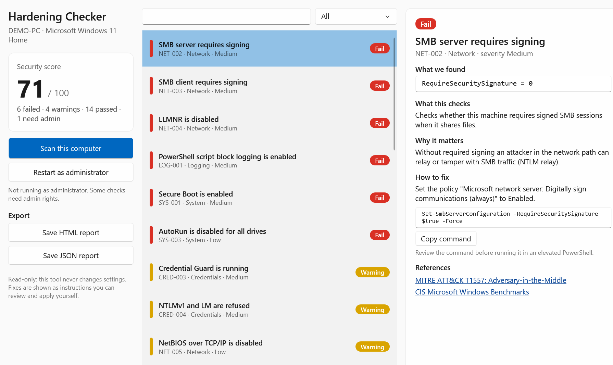
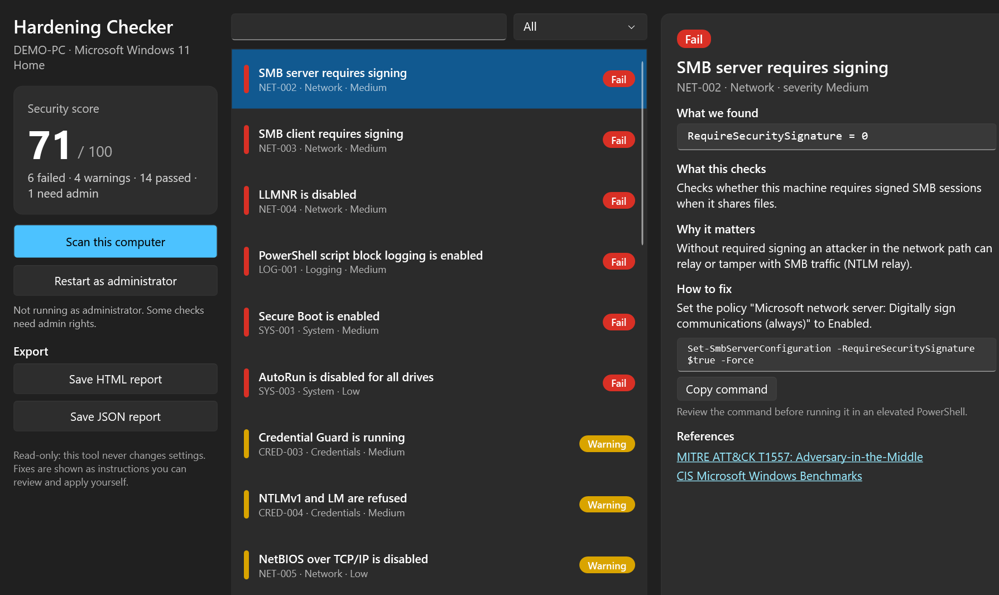

# Hardening Checker


Hardening Checker is a read-only Windows security baseline checker with a clean desktop UI. It runs 26 checks mapped to MITRE ATT&CK and the CIS Benchmarks and gives you a score. Every finding comes with a plain-language explanation of what was found, why it matters and how to fix it.



<details>
<summary>Dark theme</summary>


</details>

## Why

Most hardening scripts either change your system straight away or dump a wall of text. Hardening Checker does neither. It only reads, it shows evidence for every result and it hands you the exact command, so you stay in control of what changes.

- **Read-only by design.** The tool reads registry values and WMI classes. It never writes, never installs anything and never sends data anywhere.
- **Evidence first.** Every result shows the raw value it was based on (for example `RequireSecuritySignature = 0`).
- **Honest results.** If a check needs admin rights or does not apply to your edition, it says so instead of guessing.
- **Reports.** Export a self-contained HTML report for people and a JSON report for automation.

## Download

Grab `HardeningChecker-win-x64.zip` from the [latest release](https://github.com/JW-0042/win-hardening-checker/releases/latest). It contains two self-contained executables, so no .NET install is needed:

| File | What it is |
|---|---|
| `HardeningChecker.exe` | Desktop app (WPF, follows the Windows light or dark theme) |
| `hardening-check.exe` | Command line version for scripts and CI |

GitHub Actions builds every release and adds a signed build provenance attestation. See [SECURITY.md](SECURITY.md) for how to verify a download.

The app starts without elevation. Some checks (BitLocker and a few Defender details) need admin rights, so the app offers a "Restart as administrator" button.

## Command line

```
hardening-check [--json <file>] [--html <file>] [--quiet]
```

| Exit code | Meaning |
|---|---|
| 0 | No failed checks |
| 1 | At least one check failed |
| 2 | Invalid arguments |

This makes it easy to use as a gate in a provisioning script or a scheduled task.

## What it checks

| ID | Check | Category | Severity |
|---|---|---|---|
| NET-001 | SMBv1 protocol is disabled | Network | High |
| NET-002 | SMB server requires signing | Network | Medium |
| NET-003 | SMB client requires signing | Network | Medium |
| NET-004 | LLMNR is disabled | Network | Medium |
| NET-005 | NetBIOS over TCP/IP is disabled | Network | Low |
| NET-006 | Remote Desktop requires Network Level Authentication | Network | High |
| NET-007 | Windows Firewall is enabled for all profiles | Network | High |
| CRED-001 | WDigest does not store plaintext passwords | Credentials | High |
| CRED-002 | LSA protection (RunAsPPL) is enabled | Credentials | Medium |
| CRED-003 | Credential Guard is running | Credentials | Medium |
| CRED-004 | NTLMv1 and LM are refused | Credentials | Medium |
| CRED-005 | Anonymous enumeration is restricted | Credentials | Low |
| ACC-001 | User Account Control is enabled | Accounts | High |
| ACC-002 | Guest account is disabled | Accounts | Medium |
| ACC-003 | Built-in Administrator account is disabled | Accounts | Medium |
| ACC-004 | Local Administrators group is small | Accounts | Low |
| DEF-001 | Antivirus real-time protection is on | Defense | High |
| DEF-002 | Defender signatures are current | Defense | Medium |
| DEF-003 | Defender tamper protection is on | Defense | Medium |
| LOG-001 | PowerShell script block logging is enabled | Logging | Medium |
| LOG-002 | PowerShell 2.0 engine is removed | Logging | Medium |
| SYS-001 | Secure Boot is enabled | System | Medium |
| SYS-002 | System drive is encrypted with BitLocker | System | High |
| SYS-003 | AutoRun is disabled for all drives | System | Low |
| SYS-004 | Updates were installed recently | System | High |
| SYS-005 | Remote Registry service is disabled | System | Low |

### Scoring

Each check has a weight by severity (High 3, Medium 2, Low 1). A pass earns the full weight, a warning earns half and a fail earns nothing. Checks that need admin rights, do not apply or could not run are left out of the score instead of counting against you.

## Build from source

You need the .NET 10 SDK on Windows.

```
dotnet build HardeningChecker.slnx
dotnet test HardeningChecker.slnx
dotnet run --project src/HardeningChecker.App
```

## Project layout

```
src/HardeningChecker.Core     checks, scanner, scoring, HTML and JSON reports
src/HardeningChecker.App      WPF desktop app (MVVM, Fluent theme)
src/HardeningChecker.Cli      command line front end
tests/HardeningChecker.Tests  xUnit tests against a fake system probe
```

All system access goes through a single `ISystemProbe` interface (registry plus WMI). The tests replace it with a fake, so every check is tested for pass, fail and edge cases without touching the real machine.

## Adding a check

1. Add a `CheckDefinition` to `CheckCatalog.cs` with:
   - an ID,
   - a plain-language description,
   - the reason it matters,
   - a fix,
   - at least one reference.
2. Add tests for it in `CheckTests.cs`.

The catalog tests make sure that IDs are unique and that every check is documented.

## How this was built

I designed and wrote this tool together with an AI coding agent (Claude Code). I reviewed the design, the checks and the output on real machines. The full story, including what worked and what needed a human, is in [docs/how-this-was-built.md](docs/how-this-was-built.md).

## Disclaimer

Hardening Checker is a quick baseline check, not a full audit or a compliance certification. Test every change on a non-production machine first. Some recommended settings, such as SMB signing or disabling NetBIOS, can affect older devices on your network.

## Author

Jozef Walterstein, consultant for AI, automation and security. [walterstein.eu](https://walterstein.eu)

License: [MIT](LICENSE)
